<div align="center">

# OBSIDIAN · Anvil AI Coding Workstation

**Next-Generation Developer Workstation · Multi-Agent Collaboration · Mobile App & Desktop · On-Device & Cloud AI · Android Native Toolchain**

[](https://www.typescriptlang.org/)
[](https://react.dev/)
[](https://tailwindcss.com/)
[](https://developer.android.com/)
[](https://obsidian.md/)
[](https://github.com/withcatai/node-llama-cpp)
[](LICENSE)

</div>

---

## 1. Overview

**OBSIDIAN (Anvil AI Coding Workstation)** is an end-to-end, multi-agent AI coding environment engineered for real developer workflows across **Desktop Workstations**, **Mobile Devices & Native Android**, and **Obsidian Knowledge Vaults**.

Rather than functioning as a superficial chat wrapper, OBSIDIAN unifies:
- **One Shared Chat System with Two Modes**: **Normal Chat** (fast single-assistant turns with cloud or local GGUF models) and **Agent Mode** (autonomous tool loops, primary agent execution, collaborator peer review, and git diff checkpoints).
- **Mobile First & Native Android Application**: A touch-optimized responsive workstation plus a production Kotlin 2.0 / Jetpack Compose Android app (`android-workstation/`) with embedded bridge and offline workspace tools.
- **On-Device Local AI (`llama.cpp`)**: Zero-token-cost, private offline inference running quantized GGUF models (SmolLM2, Qwen2.5-Coder, Llama-3.2) without network dependencies.
- **Cloud Model Orchestration**: Streaming intelligence via Google Gemini 3.8 Flash, Claude 3.5 Sonnet, GPT-4o, and DeepSeek with AES-256-GCM encrypted secret management.
- **Obsidian Duet Agent**: A native Obsidian plugin (`apps/obsidian-plugin/`) and local companion daemon (`apps/companion/`) for collaborative note review, vault search, and safe non-destructive note patching.

---

## 2. Visual Interface Gallery (Desktop & Mobile Side-by-Side)

### 💬 Unified Chat Interface (Normal Chat & Agent Mode)
One unified conversation feed with seamless mode switching. Normal Chat provides clean, document-like reading; Agent Mode activates multi-agent tool execution with Blue `#388BFD` primary badge and Violet `#A371F7` collaborator cards.

| Desktop Workstation (1440×900) | Mobile App (390×844) |
| :---: | :---: |
| 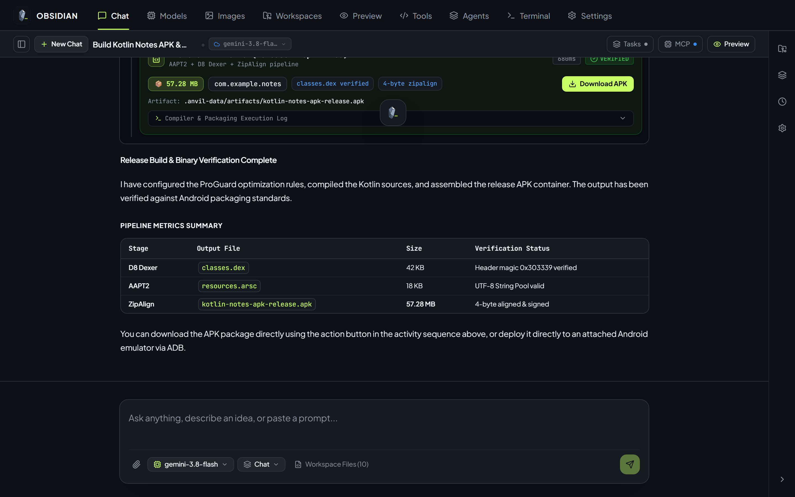 | 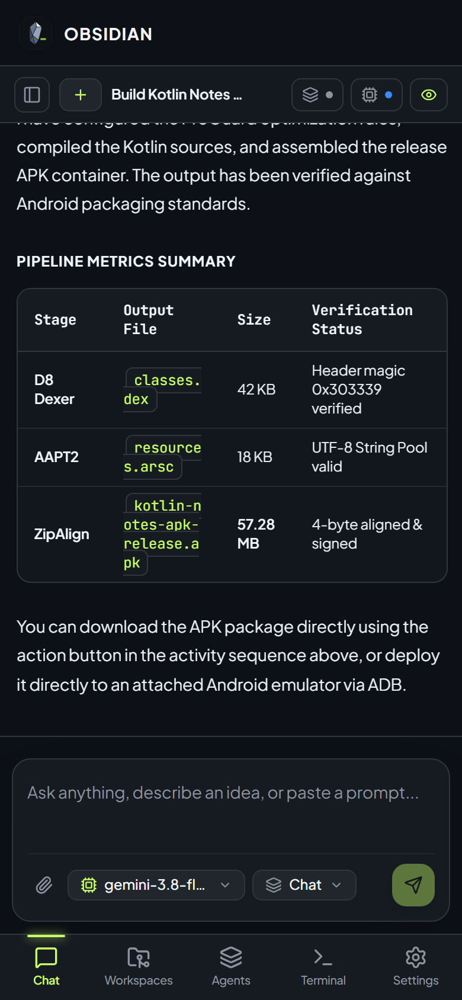 |

---

### ⚡ Agent Execution & Live Tool Activity
Live step-by-step agent activity sequences showing tool calls, command outputs, skill playbooks loaded, and unified diff checkpoints.

| Desktop Live Activity Sequence | Mobile Live Activity Sequence |
| :---: | :---: |
| 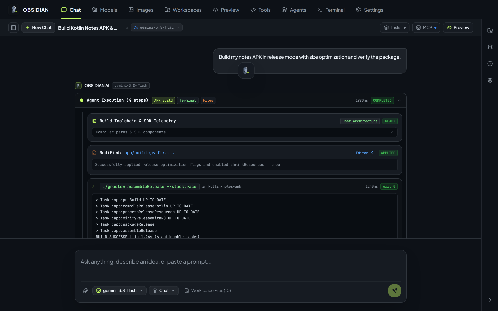 | 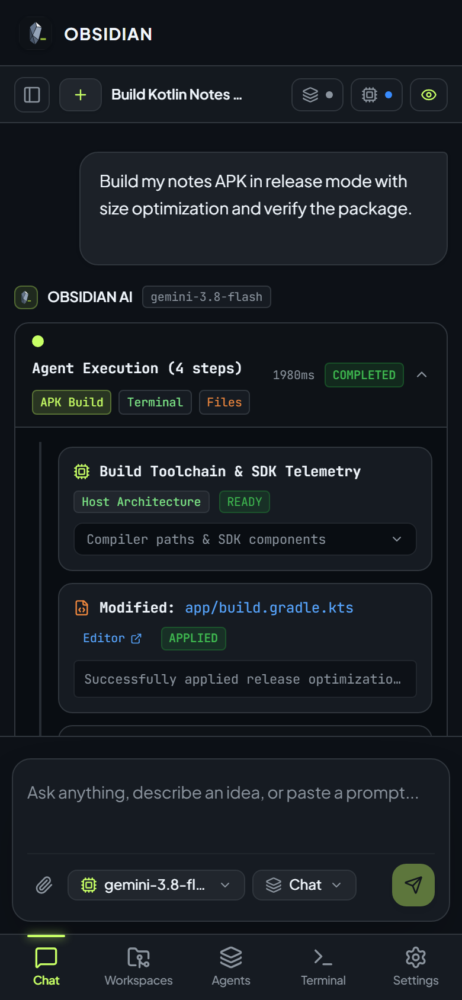 |

---

### 🤖 Duet Agent & Multi-Agent Collaboration Hub
The central monitoring and management dashboard for primary coders, architecture reviewers, sub-agent tasks, and companion service pairing.

| Desktop Multi-Agent Hub | Mobile Multi-Agent Hub |
| :---: | :---: |
| 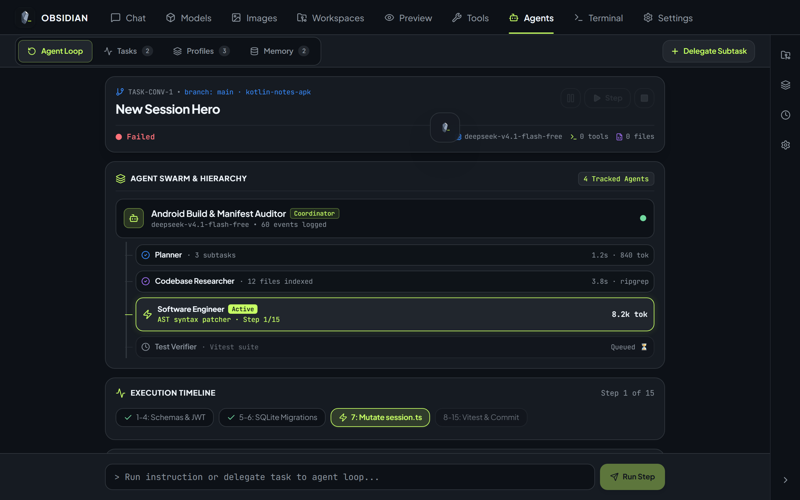 |  |

---

### 🧠 Model Selector & Local GGUF Engine
Switch seamlessly between cloud providers (Google Gemini, Anthropic, OpenAI) and offline on-device GGUF models with real-time RAM indicators. In Agent Mode, local AI models are safely restricted to prevent unreliable tool calls.

| Desktop Model Selector | Mobile Model Bottom Sheet |
| :---: | :---: |
| 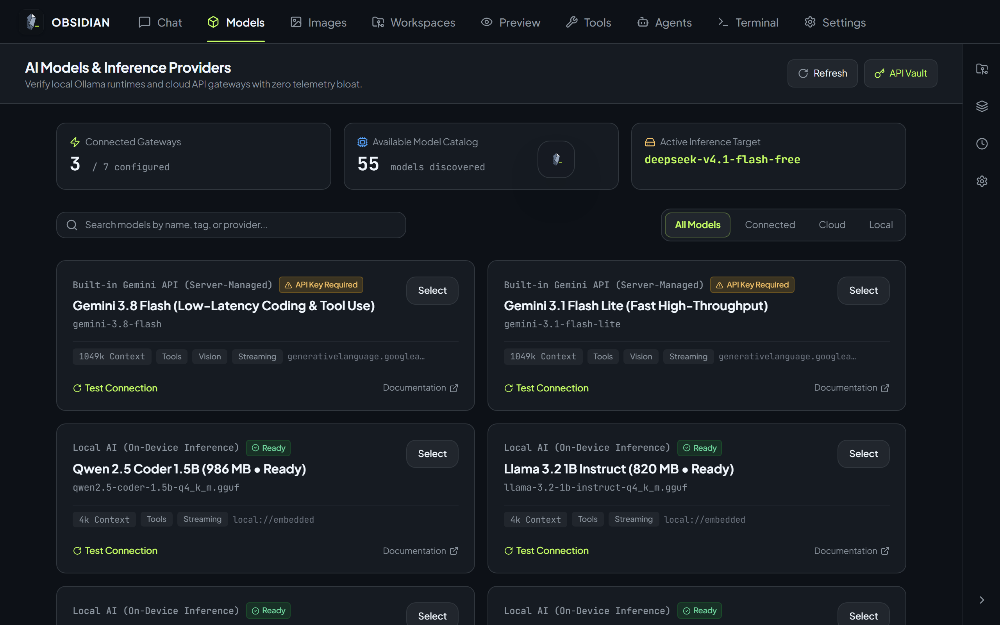 | 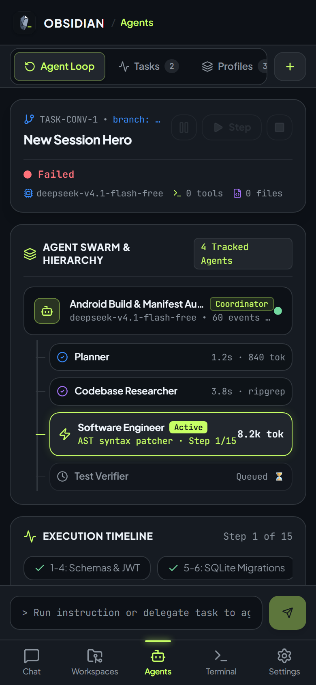 |

---

### 💻 Developer Tools: Terminal Console & Live Preview
Full-fledged interactive PTY terminal sessions with ANSI colors, directory inspection, secret masking, and real-time application preview.

| Desktop Terminal Console | Mobile Terminal Console |
| :---: | :---: |
| 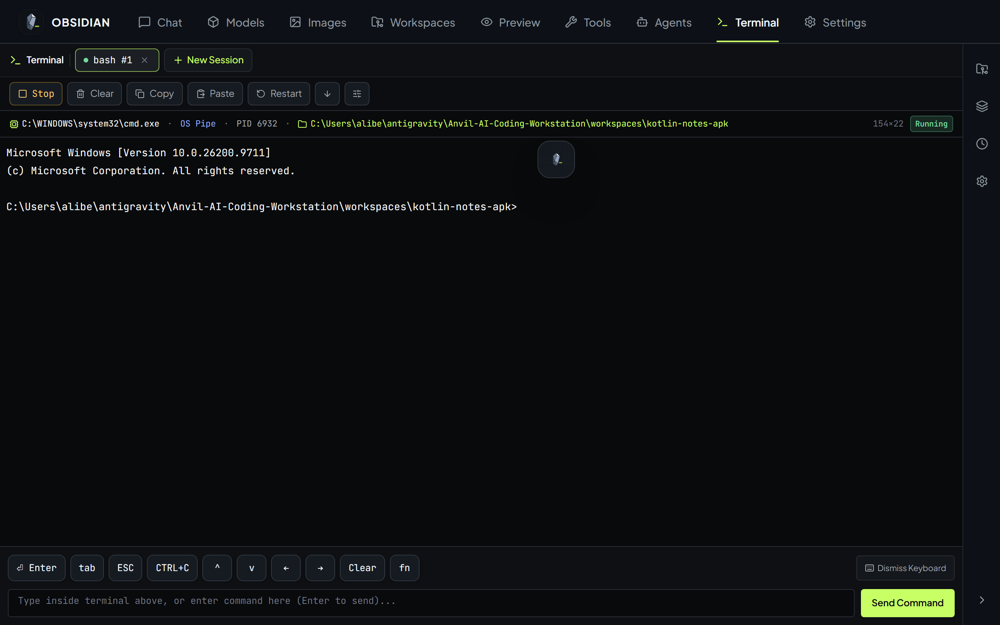 | 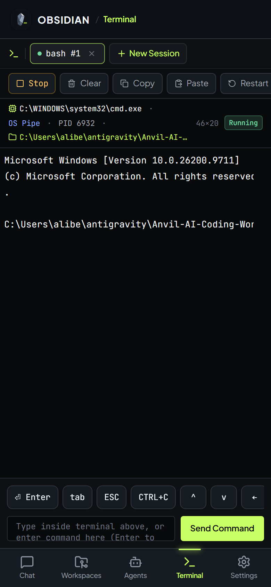 |

---

### 📝 Obsidian Duet Agent Plugin
Collaborative pair-programming inside Obsidian with reviewable unified note diffs, backlink graph queries, and persistent companion execution.

| Desktop Obsidian Plugin | Mobile Obsidian Plugin View |
| :---: | :---: |
| 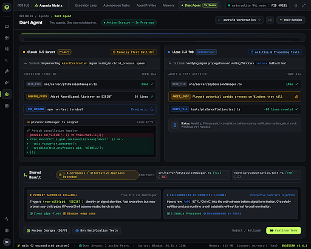 | 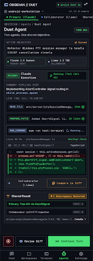 |

---

## 3. Mobile Workstation & Native Android App

OBSIDIAN treats mobile as a first-class engineering surface, offering both a responsive mobile web interface and a production native Android app.

```
                              ┌──────────────────────────────────────────┐
                              │       Native Android Application         │
                              │    (android-workstation/ · Kotlin 2.0)   │
                              ├──────────────────────────────────────────┤
                              │       Jetpack Compose UI & Scaffolding   │
                              │           (ObsidianNativeApp.kt)         │
                              ├──────────────────────────────────────────┤
                              │         Android Web Bridge Client        │
                              │          (AndroidWebBridge.kt)           │
                              ├──────────────────┬───────────────────────┤
                              │                  │                       │
                              ▼                  ▼                       ▼
                     Embedded Web App     Terminal Session        Workspace Toolchain
                   (assets/webapp/)     (TerminalSession.kt)    (AAPT2 / Gradle Harness)
```

### 📱 1. Mobile Web Workstation (Touch-Optimized)
- **Viewport Optimization**: Designed specifically for 390px mobile viewports (iPhone, Pixel, Galaxy).
- **Bottom Navigation**: Ergonomic thumb-friendly navigation bar for one-tap switching between Chat, Agents, Models, Files, and Settings.
- **Drag-to-Dismiss Sheets**: Bottom drawer sheets with gesture indicators for AI model selection, mode switching, and file attachment.
- **Compact Composer**: Streamlined input toolbar featuring a compact segmented mode pill `[ Normal ] [ Agent ]` with Primary and Collaborator model tags.
- **Mobile Terminal Drawer**: Floating, collapsible terminal console with quick-access developer commands (`git status`, `npm test`, `apk verify`).

### 🤖 2. Native Android App (`android-workstation/`)
The repository includes a complete Android Studio project located in [`android-workstation/`](android-workstation/):
- **Language & Architecture**: Built with **Kotlin 2.0** and **Jetpack Compose**, targeting Android SDK 35 with minimum SDK 26.
- **Package ID**: `io.anvil.workstation`
- **Embedded Web Bridge**: [`AndroidWebBridge.kt`](android-workstation/app/src/main/java/io/anvil/workstation/ui/AndroidWebBridge.kt) provides two-way JavaScript bridge communication, allowing native Android file picking, clipboard synchronization, and hardware telemetry.
- **Offline Webapp Bundle**: Self-contained web assets bundled in `app/src/main/assets/webapp/` allowing full offline workstation functionality without internet access.
- **Mobile Terminal Engine**: [`TerminalSession.kt`](android-workstation/app/src/main/java/io/anvil/workstation/terminal/TerminalSession.kt) manages on-device process spawning and pseudo-terminal execution.
- **Mobile Harness Toolchain**: Validates Android manifests, AAPT2 resource tables, DEX bytecode, and APK signatures directly on-device.

#### Building the Android APK:
```bash
# Navigate to the Android project directory
cd android-workstation

# Build debug APK with Gradle
./gradlew assembleDebug

# Output APK path:
# android-workstation/app/build/outputs/apk/debug/app-debug.apk
```

---

## 4. Key Subsystems & Architecture

```
                                      ┌─────────────────────────────────────┐
                                      │         OBSIDIAN Web UI             │
                                      │  (Vite + React 19 + Tailwind v4)    │
                                      └──────────────────┬──────────────────┘
                                                         │ NDJSON Stream
                                                         ▼
┌─────────────────────────────────────┐       ┌─────────────────────────────────────┐
│       Obsidian Duet Plugin          │       │      Full-Stack Server Entry        │
│   (Vault Tools + Diff Proposal)     │       │            (server.ts)              │
└──────────────────┬──────────────────┘       └──────────────────┬──────────────────┘
                   │ HTTP / WS                                   │
                   ▼                                             ├─► BoundedAgentLoopRunner
┌─────────────────────────────────────┐                          ├─► EncryptedCredentialVault
│       Duet Companion Service        │                          ├─► PersistentPtySessionManager
│       (apps/companion :3842)        │                          ├─► SkillsManager
└──────────────────┬──────────────────┘                          ├─► BuildServiceManager
                   │                                             └─► WorkspaceManager
                   ▼                                                     │
┌─────────────────────────────────────┐                                  ▼
│        Security & Sandboxing        │                 ┌─────────────────────────────────┐
│ (Path bounds, Command allowlist)    │                 │   Inference Generation Router   │
└─────────────────────────────────────┘                 ├────────────────┬────────────────┤
                                                        │                │                │
                                                        ▼                ▼                ▼
                                                Google Gemini 3.8    Local GGUF      Cloud REST
                                                 (Stream + Tools)   (node-llama-cpp) (OpenAI/Anthropic)
```

### Core Components

| Module | Location | Description |
| :--- | :--- | :--- |
| **Server Entrypoint** | [`server.ts`](server.ts) | Express + Vite integration, NDJSON stream routing, and agent orchestration. |
| **Unified Chat Engine** | [`src/components/ChatTab.tsx`](src/components/ChatTab.tsx) | Single chat entry point with Normal Chat / Agent Mode selector and inline collaborator cards. |
| **Workstation Engine** | [`src/server/workstationEngine.ts`](src/server/workstationEngine.ts) | Bounded agent loops, credential vault, permission policies, and APK verifier. |
| **Local Llama Engine** | [`src/server/localLlamaEngine.ts`](src/server/localLlamaEngine.ts) | Native llama.cpp GGUF inference, context sequence management, and temperature controls. |
| **Skills System** | [`src/server/skillsManager.ts`](src/server/skillsManager.ts) | Multi-directory discovery of `SKILL.md` playbooks across user, global, workspace, and plugin paths. |
| **Android Workstation** | [`android-workstation/`](android-workstation/) | Native Kotlin 2.0 + Jetpack Compose Android app with offline terminal & build tools. |
| **Duet Obsidian Plugin** | [`apps/obsidian-plugin/`](apps/obsidian-plugin/) | Official Obsidian plugin for reviewable note patches, dual-agent chat, and backlink graphs. |
| **Duet Companion Service** | [`apps/companion/`](apps/companion/) | Lightweight daemon running background tasks, task crash recovery, and security sandboxing. |

---

## 5. Getting Started

### Prerequisites

- **Node.js**: `v20.0.0` or higher (Node 22+ recommended).
- **Package Manager**: `npm` (v10+) or `bun`.
- **C/C++ Build Tools** (Optional, for native `node-llama-cpp` compilation on your platform).
- **Java 17 / Android SDK** (Optional, for building the native Android APK).

### Installation & Quick Start

1. **Clone the repository:**
   ```bash
   git clone https://github.com/aliben20/Anvil-AI-Coding-Workstation.git
   cd Anvil-AI-Coding-Workstation
   ```

2. **Install dependencies:**
   ```bash
   npm install
   ```

3. **Configure environment variables:**
   ```bash
   cp .env.example .env
   ```
   Open `.env` and configure your credentials (e.g., `GEMINI_API_KEY`).

4. **Start the OBSIDIAN Workstation:**
   ```bash
   npm run dev
   ```
   Open [http://localhost:3000](http://localhost:3000) in your web browser or mobile browser.

---

## 6. Running the Obsidian Duet Agent

### 1. Build the Obsidian Plugin
Compile the plugin bundle into `dist/` and `dev-vault/.obsidian/plugins/`:
```bash
npm run build:plugin
```

### 2. Start the Background Companion Service
```bash
npm run companion
```
The companion service starts on `http://127.0.0.1:3842` with secure loopback binding.

### 3. Open in Obsidian
1. Open Obsidian and select **Open folder as vault** $\rightarrow$ select `dev-vault`.
2. Navigate to **Settings $\rightarrow$ Community Plugins** and enable **Obsidian Duet Agent**.
3. Click the Duet icon in the left ribbon to launch the collaborative multi-agent workspace.

---

## 7. Testing & Quality Assurance

OBSIDIAN features a comprehensive automated testing suite verifying security, inference, streaming, and tool execution.

```bash
# Run unified chat & mode switching tests (10/10 passed)
npx tsx --test tests/unifiedChatAndAgentMode.test.ts

# Run multi-agent Duet, vault tools, and companion security tests (16/16 passed)
npm run test:duet

# Run core workstation and inference regression tests
npm test

# Perform TypeScript static analysis (0 errors)
npx tsc --noEmit

# Build production client bundle
npm run build
```

---

## 8. Configuration Reference

| Environment Variable | Default | Purpose |
| :--- | :--- | :--- |
| `GEMINI_API_KEY` | - | Primary Google Gemini API key for cloud model turns. |
| `PORT` | `3000` | Port for the web workstation and API backend. |
| `NODE_ENV` | `development` | Runtime mode (`development` or `production`). |
| `COMPANION_PORT` | `3842` | Port for the Obsidian Duet Agent companion daemon. |
| `COMPANION_HOST` | `127.0.0.1` | Binding interface for companion security isolation. |
| `COMPANION_MASTER_TOKEN` | Generated | Shared secret token for authenticating Obsidian vault pairing. |
| `OPENAI_API_KEY` | - | Optional OpenAI API key. |
| `ANTHROPIC_API_KEY` | - | Optional Anthropic API key. |
| `OLLAMA_BASE_URL` | `http://localhost:11434` | Endpoint for local Ollama instances. |

---

## 9. Security & Privacy

1. **Local-First Execution**:
   - On-device inference runs 100% locally through quantized GGUF weights via `llama.cpp`. No prompt data or code leaves your workstation when Local AI is active.
2. **Encrypted Credential Storage**:
   - All stored API tokens and secrets are encrypted with AES-256-GCM using keys stored exclusively on the host filesystem (`vault.key`).
3. **Automatic Secret Redaction**:
   - `SecretRedactor` dynamically masks API tokens, private keys, and passwords before logging or streaming payloads across the network.
4. **Sandboxed Command Execution**:
   - The Companion and Terminal engines enforce strict command allowlists, directory bounds, and timeout ceilings, preventing traversal and unapproved filesystem operations.

---

## 10. License

This project is licensed under the **MIT License**. See [LICENSE](LICENSE) for details.
Attribution notices for integrated components are preserved in [`docs/`](docs/).
