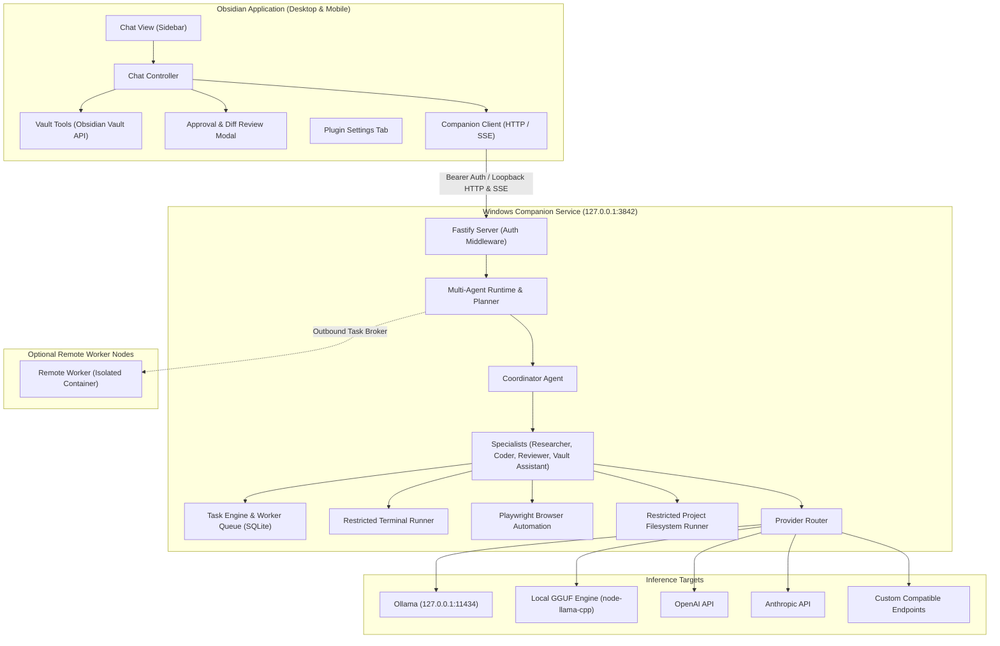

# Obsidian Duet Agent — Architecture & Protocol Specification

## 1. System Architecture

## 2. Trust Boundaries & Security Rules

1. **Vault Security**:
   - The plugin strictly uses Obsidian's official `Vault` API (`vault.read`, `vault.modify`, `vault.create`, `vault.delete`) for all vault interactions.
   - Arbitrary filesystem traversal from within the plugin is disallowed.

2. **Companion Authentication & Pairing**:
   - The companion listens exclusively on loopback (`127.0.0.1`).
   - Pairing is initialized with a cryptographically secure random token (64 hex characters) stored in `.obsidian-duet/companion-token.secret` with restrictive permissions.
   - All HTTP and streaming requests must provide the bearer header: `Authorization: Bearer <TOKEN>`.
   - Unauthorized requests immediately receive HTTP 401.

3. **External Project Roots**:
   - Project filesystem operations outside the vault require explicit registration in the companion configuration.
   - Real-path canonicalization (`fs.realpathSync`) is enforced to prevent symlink, directory junction, or traversal (`..`) escapes.

4. **Restricted Terminal**:
   - Direct process spawning (`child_process.spawn`) with separated executable and argument arrays.
   - Shell command string concatenation is prohibited.
   - Executable allowlist: git, npm, node, python, etc.
   - Environment variables are filtered to strip sensitive system secrets.
   - Execution timeouts and bounded output buffers are enforced.

5. **Isolated Browser Automation**:
   - Playwright runs in isolated incognito browser contexts.
   - Private network addresses (e.g. `169.254.169.254`, `localhost`, `10.0.0.0/8`, `192.168.0.0/16`) are blocked by default unless explicitly allowed.
   - No access to user browser profiles, cookies, or saved credentials.

6. **Approval & Consequential Actions**:
   - File modifications, terminal commands with side effects, form submissions, and external network requests trigger a user approval request with inline unified diff previews.
   - Rejected actions leave target files and system state completely untouched.

7. **SQLite Persistence**:
   - Uses Node.js native `node:sqlite` (`DatabaseSync`) for transactions, zero native compilation issues, and crash recovery.
   - Tasks recover gracefully to `interrupted` or `paused` state on restart.
